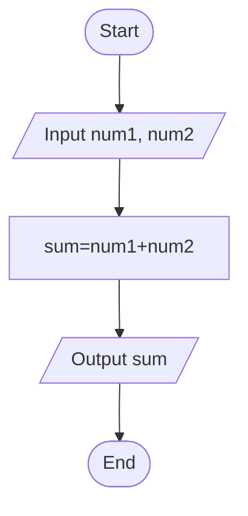
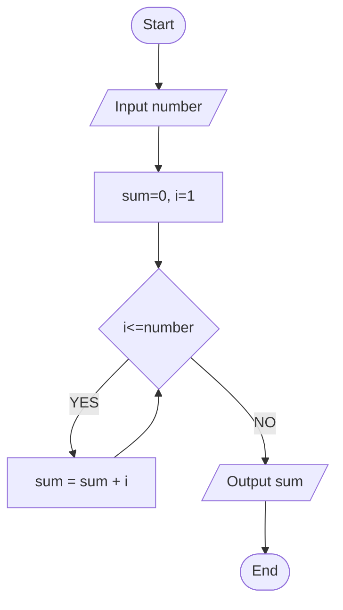

## Algorithm

- **Algorithm**: **Step-by-step instructions** to solve a problem using simple language.

```
Step 1: Start
Step 2: Input num1, num2
Step 3: sum = num1 + num2
Step 4: Output sum
Step 5: End
```

## FlowChart

- **Flowchart**: A **visual representation** of an algorithm using symbols and arrows.



another example of flowchart for all diagram used



## Pseudocode

- **Pseudocode**: A structured, **code-like representation** of an algorithm that is **independent of any programming language**.

```
BEGIN
  INPUT num1, num2
  sum ← num1 + num2
  OUTPUT sum
END
```

## Ex

- sum and avg of two numbers
- sum and avg of three numbers
- sum and avg of n numbers
- greatest and smallest of two numbers
- greatest and smallest of three numbers
- fahrenheit to celsius
- area of circle
- factorial of a positive integer number
