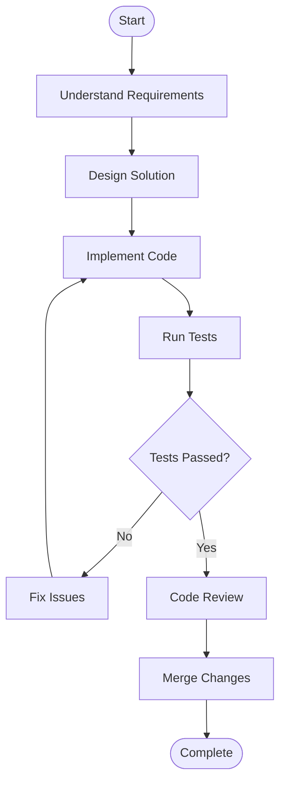

# c-language-learning

A structured C programming learning repository

## Topics

- Introduction to programming
  - Translator Programming
    - Compiler
    - Interpreter
    - Assembler
  - Algorithm, Flowchart, Pseudocode
  - C Intro
- Input Output
  - Token
    - Keywords
    - Escape Sequence
    - Punctuators
    - Operators
  - Data Types and Variable
- Operator
  - Area, perimeter of rectangle, square, triangle, circle(circumference) -> A, F, C
  - sum, avg (2, 3 numbers)
  - conversion (C<->F<->K) (m<->f)
- Math
- Control Statement
  - Conditional Control Statement (if, if else, else if, switch)
    - Even Odd
    - Positive Negative
    - Largest Smallest
    - Leap Year
    - Small Capital
    - Vowel Consonant
  - Loop Control Statement (for, while, do...while)
    - print 1 to 100
    - print 1 to 100 Even Odd
    - series
    - patterns
    - Fibonacci Series
    - Prime
    - gcd lcm
    - Multiplication Table
    - Factorial
- Array
  - 1D
  - 2D
- String
- Function
- Recursion
- Structure
- Pointer
- File
- Advance C

## Mermaid For FlowChart

- [mermaid doc](https://mermaid.js.org/syntax/flowchart.html)
